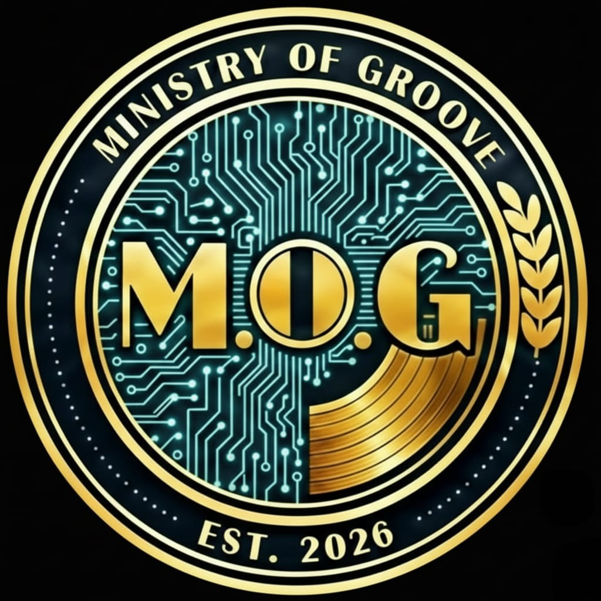

# 📀 MINISTRY OF GROOVE | NCC MASTER v5.1
**Central Operations Gate & Classified Cultural Archive**

## 🌐 Project Overview
The **NCC MASTER** is a high-security Progressive Web App (PWA) designed for the management of cultural assets, personnel dossiers, and frequency surveillance within Sector 7G. Built with a "Ministry Terminal" aesthetic, it utilizes a modular architecture with enterprise-grade encryption and real-time synchronization.

**Version:** 5.1.0  
**Last Updated:** 2026-03-16  
**Classification:** CONFIDENTIAL // SEC-7G

## 🛠 Tactical Stack
| Layer | Technology | Purpose |
|-------|------------|---------|
| **Frontend** | HTML5, CSS3, Tailwind CSS | Tactical UI/UX |
| **State** | Alpine.js 3.x | Reactive components |
| **Backend** | Supabase (Auth, PostgreSQL, Storage) | Secure data & real-time |
| **Crypto** | Web Crypto API (AES-GCM, SHA-256) | Client-side encryption |
| **CI/CD** | GitHub Actions | Automated deployment |
| **Hosting** | Vercel + AWS S3/CloudFront | Edge distribution |
| **PWA** | Service Worker | Offline capability |

## 📂 Repository Structure
